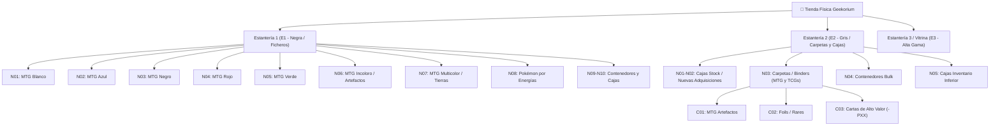

# 📍 Estructura de Ubicación Física de Singles en Tienda — Geekorium

> **Tipo:** Guía Operativa & Estándar de Almacén  
> **Área:** Tienda Física, Inventario, Odoo ERP, Web Admin  
> **Última actualización:** Noviembre 2026  
> **Relacionado con:** [[00 - Geekorium Vault Hub]], [[docs/PRD_MASTER]], [[GUIA_ADMINISTRACION]]

---

## 🧭 1. Estructura del Código de Ubicación (4 Niveles)

Asigna a cada contenedor una coordenada única con el formato jerárquico estándar:

$$\mathbf{[ESTANTERÍA]-[ENTREPAÑO]-[CONTENEDOR]-[CATEGORÍA]}$$

### Desglose de Segmentos:

1. **Estantería (`E1`, `E2`, `E3`...):** Identifica el mueble físico completo.
   - `E1`: Estantería negra de la derecha (10 niveles de ficheros organizados por color/energía).
   - `E2`: Estantería gris de la izquierda (5 niveles para carpetas, cajas y contenedores).
   - `E3`: Tercera estantería o vitrina de seguridad para singles de alto valor.
2. **Entrepaño / Nivel (`N01` a `N10`):** Numerados de **arriba hacia abajo** (`N01` es el nivel superior y `N05` o `N10` el nivel inferior).
3. **Contenedor + Posición (`C` / `F` / `B`):** Numerados de **izquierda a derecha** dentro de su entrepaño:
   - `C`: Carpeta / Binder (`C01`, `C02`, ...).
   - `F`: Fichero / Caja de cartón de almacenamiento (`F01`, `F02`, ...).
   - `B`: Contenedor plástico / Box (`B01`, `B02`, ...).
4. **Categoría legible:** Abreviatura del juego y contenido temático:
   - MTG: `MTG-ART` (Artefactos), `MTG-W` (Blanco), `MTG-U` (Azul), `MTG-B` (Negro), `MTG-R` (Rojo), `MTG-G` (Verde), `MTG-M` (Multicolor), `MTG-L` (Tierras/Lands).
   - Pokémon: `PKM-FUE` (Fuego), `PKM-AGU` (Agua), `PKM-L` (Lucha), etc.
   - One Piece: `OP-ROJ` (Rojo), `OP-AZU` (Azul), `OP-VER` (Verde), etc.

### Paginación en Carpetas (Opcional - Cartas de Alto Valor):
Para carpetas con cartas de alto valor donde se requiera precisión exacta por página, se agrega el sufijo `-P[XX]` al final:
- `E2-N03-C01-P04` = Estantería 2, Entrepaño 3, Carpeta 1, Página 4.

### Ejemplos Prácticos:

| Caso | Código Corto (Etiqueta & CSV) | Lectura en Pantalla (Odoo / Web / Terminal) |
| :--- | :--- | :--- |
| *Black Lotus* (Carpeta Artefactos) | `E2-N03-C01-MTG-ART` | `Estantería 2 > Entrepaño 3 > Carpeta 01 (MTG Artefactos)` |
| *Lightning Bolt* (Fichero Rojo MTG) | `E1-N04-F01-MTG-R` | `Estantería 1 > Entrepaño 4 > Fichero 01 (MTG Rojo)` |
| *Pikachu* (Fichero Pokémon Eléctrico) | `E1-N08-F02-PKM-ELE` | `Estantería 1 > Entrepaño 8 > Fichero 02 (Pokémon Eléctrico)` |

---

## 🏛️ 2. Mapeo Aplicado a las Estanterías Actuales

Distribución física real de las estanterías de Geekorium:

| Mueble | Nivel (Arriba $\rightarrow$ Abajo) | Contenido Físico Actual | Ejemplo de Código de Ubicación | Descripción Visible en Sistema |
| :--- | :--- | :--- | :--- | :--- |
| **Estantería 1 (`E1`)** *(Derecha - Negra)* | **Entrepaño 1 (`N01`)** | Ficheros MTG Blanco | `E1-N01-F01-MTG-W` | Estantería 1 > Entrepaño 1 > Fichero 01 (MTG Blanco) |
| **Estantería 1 (`E1`)** *(Derecha - Negra)* | **Entrepaño 2 (`N02`)** | Ficheros MTG Azul | `E1-N02-F01-MTG-U` | Estantería 1 > Entrepaño 2 > Fichero 01 (MTG Azul) |
| **Estantería 1 (`E1`)** *(Derecha - Negra)* | **Entrepaño 3 (`N03`)** | Ficheros MTG Negro | `E1-N03-F01-MTG-B` | Estantería 1 > Entrepaño 3 > Fichero 01 (MTG Negro) |
| **Estantería 1 (`E1`)** *(Derecha - Negra)* | **Entrepaño 4 (`N04`)** | Ficheros MTG Rojo | `E1-N04-F01-MTG-R` | Estantería 1 > Entrepaño 4 > Fichero 01 (MTG Rojo) |
| **Estantería 1 (`E1`)** *(Derecha - Negra)* | **Entrepaño 5 (`N05`)** | Ficheros MTG Verde | `E1-N05-F01-MTG-G` | Estantería 1 > Entrepaño 5 > Fichero 01 (MTG Verde) |
| **Estantería 1 (`E1`)** *(Derecha - Negra)* | **Entrepaño 6 (`N06`)** | Ficheros MTG Incoloro / Artefactos | `E1-N06-F01-MTG-C` | Estantería 1 > Entrepaño 6 > Fichero 01 (MTG Incoloro) |
| **Estantería 1 (`E1`)** *(Derecha - Negra)* | **Entrepaño 7 (`N07`)** | Ficheros MTG Multicolor / Tierras | `E1-N07-F01-MTG-M` | Estantería 1 > Entrepaño 7 > Fichero 01 (MTG Multicolor) |
| **Estantería 1 (`E1`)** *(Derecha - Negra)* | **Entrepaño 8 (`N08`)** | Ficheros Pokémon por Energías | `E1-N08-F01-PKM-L` | Estantería 1 > Entrepaño 8 > Fichero 01 (Pokémon Lucha) |
| **Estantería 1 (`E1`)** *(Derecha - Negra)* | **Entrepaños 9 y 10 (`N09`-`N10`)** | Contenedores plásticos y cajas base | `E1-N09-B01-OP` | Estantería 1 > Entrepaño 9 > Contenedor 01 |
| **Estantería 2 (`E2`)** *(Izquierda - Gris)* | **Entrepaños 1 y 2 (`N01`-`N02`)** | Cajas de cartón / Nuevas adquisiciones / Playmats | `E2-N01-F01-STOCK` | Estantería 2 > Entrepaño 1 > Caja 01 |
| **Estantería 2 (`E2`)** *(Izquierda - Gris)* | **Entrepaño 3 (`N03`)** | **Carpetas (Binders)** de MTG y otros TCG | `E2-N03-C01-MTG-ART` | Estantería 2 > Entrepaño 3 > Carpeta 01 (Artefactos) |
| **Estantería 2 (`E2`)** *(Izquierda - Gris)* | **Entrepaño 4 (`N04`)** | Contenedores plásticos apilados (Bulk / Accesorios) | `E2-N04-B01-BULK` | Estantería 2 > Entrepaño 4 > Contenedor 01 |
| **Estantería 2 (`E2`)** *(Izquierda - Gris)* | **Entrepaño 5 (`N05`)** | Cajas e inventario en nivel inferior | `E2-N05-F01-VAR` | Estantería 2 > Entrepaño 5 > Caja 01 |

---

## ⚡ 3. Flujo de Ingestión y Carga de Ubicaciones

Para evitar escribir la ubicación carta por carta, el flujo se basa en **escanear y exportar por contenedor cerrado** (1 archivo CSV = 1 carpeta o 1 fichero específico):

### Paso a Paso Operativo:

1. **Nombramiento del Archivo de Escaneo con la Ubicación:**
   - Al escanear con **ManaBox** o **SortSwift**, procesar únicamente un contenedor a la vez e incluir el código al inicio del nombre del archivo:
     - `E2-N03-C07_MTG_Carpeta_Artefactos_20261103.csv`
     - `E1-N01-F02_MTG_Blanco_Criaturas_CMC2_20261103.csv`

2. **Asignación en Bloque antes de Subir el CSV:**
   - **En SortSwift:** Seleccionar todas las cartas escaneadas del contenedor (*Select All* $\rightarrow$ *Bulk Edit*) y en el campo **Location / Remark** colocar la ubicación formateada:  
     `Estantería 2 - Entrepaño 3 - Carpeta 07 (Artefactos)`. Al exportar, todas las filas llevarán esa columna poblada.
   - **En ManaBox:** Abrir el CSV exportado en Excel o Google Sheets, agregar la columna `Ubicacion` (o `Ubicación Física`) y rellenar con `E2-N03-C07 | Estantería 2 - Entrepaño 3 - Carpeta Artefactos` todas las filas del archivo.

3. **Mapeo en Sistema (Odoo / Geekorium Web):**
   - **Opción Rápida (Campo en Ficha de Inventario / Producto — Recomendada):**  
     Campo `physical_location` / `x_ubicacion_estanteria`. Al buscar cualquier carta en el Punto de Venta (POS) o en el Panel Admin, el personal visualiza de inmediato:  
     `Ubicación: E2-N03-C07 (Estantería 2, Entrepaño 3, Carpeta Artefactos)`.
   - **Opción Avanzada (Multi-Ubicación de Almacén en Odoo):**  
     Si una misma carta (ej. *Sol Ring* de la misma edición) convive simultáneamente en la Carpeta de Artefactos (`E2-N03-C01`) y en el Fichero de Incoloros (`E1-N06-F01`), se configuran ubicaciones internas de almacén (`WH/Stock/E1-N06-F01` y `WH/Stock/E2-N03-C01`) para balancear cantidades exactas en cada punto.

---

## 🏷️ 4. Protocolo de Rotulado y Etiquetado Físico

Para preservar la sincronía entre el sistema digital y la tienda física:

1. **Postes Verticales:**
   - Etiqueta de gran formato en la parte superior:  
     - `ESTANTERÍA 1 (E1)` — Derecha / Negra
     - `ESTANTERÍA 2 (E2)` — Izquierda / Gris
2. **Frente de Vigas Metálicas:**
   - En el extremo izquierdo de cada viga, etiqueta con el identificador del nivel: `N01`, `N02`, `N03`...
3. **Lomo de Carpetas y Frontal de Ficheros:**
   - Etiqueta con la coordenada completa:  
     Ejemplo: `E2 - N03 - C07 | ARTEFACTOS`.  
   - Garantiza que cualquier miembro del equipo pueda devolver el contenedor exactamente a su coordenada sin desordenar el inventario.

---

## 🗺️ 5. Diagrama Jerárquico de Ubicaciones

